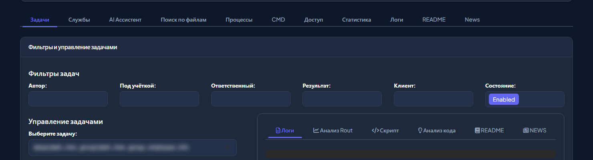
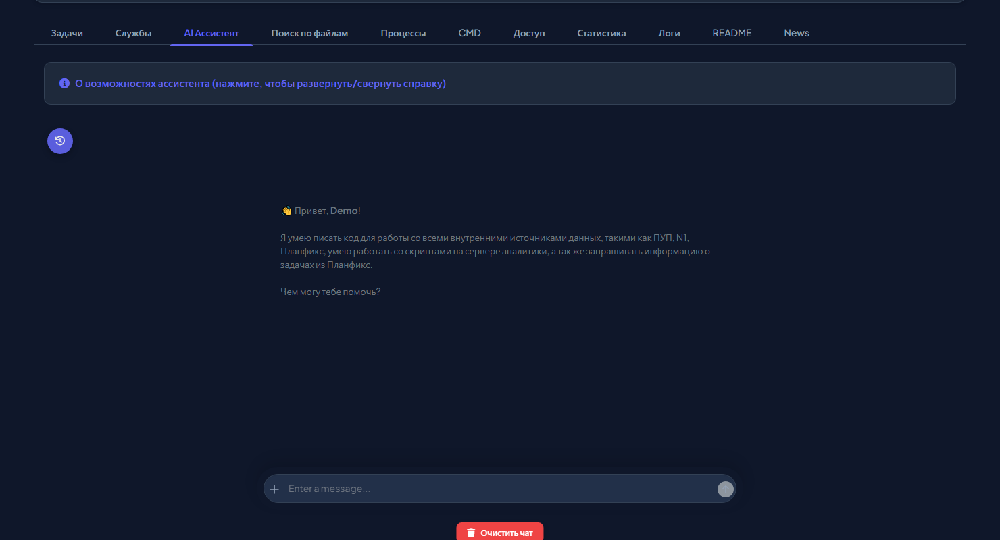
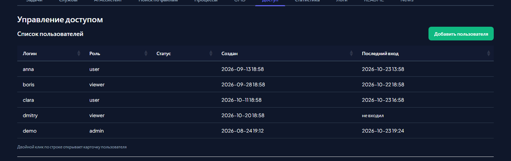
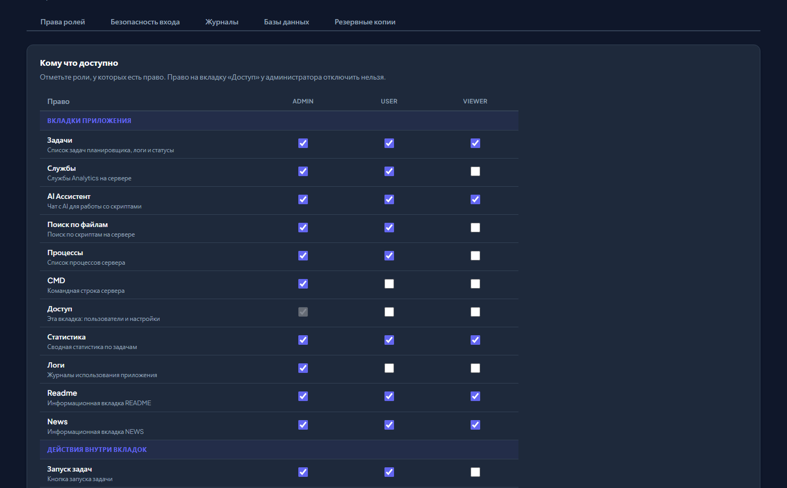
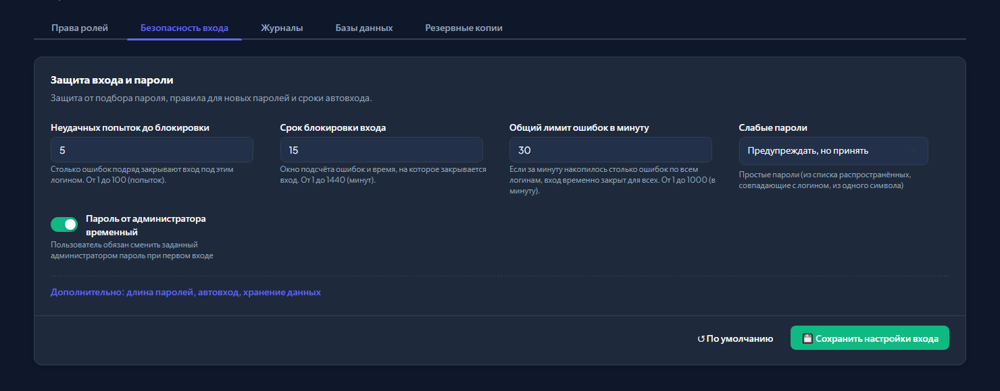
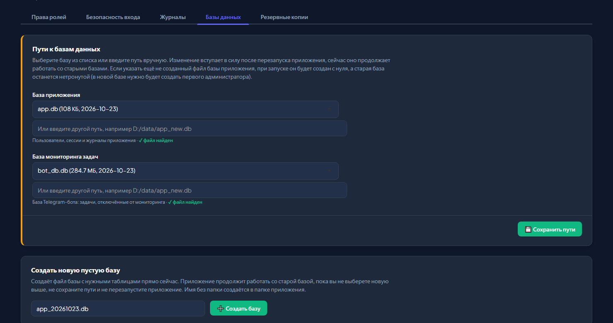
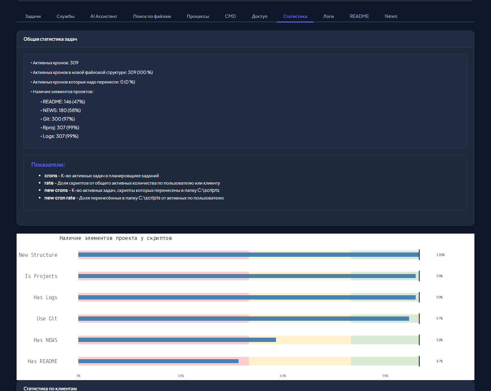
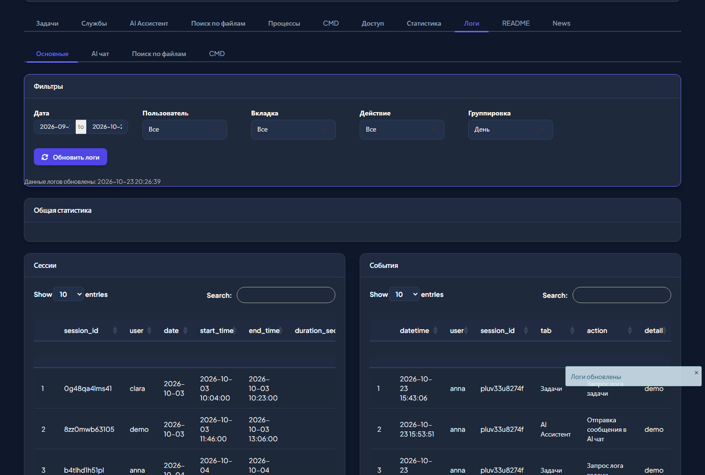

# 🖥️ Server Manager

**Веб-приложение отдела аналитики для работы с сервером:** задачи планировщика, службы, процессы, логи скриптов, статистика и AI-ассистент в одном окне.

Адрес: [Server Manager](http://94.130.22.47/). Вход по логину и паролю, их выдаёт администратор приложения.

---

## ✨ Для чего это нужно

- **Разобрать упавшую задачу за пару минут:** увидеть лог, код скрипта и получить от AI объяснение ошибки и план исправления.
- **Не заходить на сервер руками:** запустить, включить или выключить задачу, перезапустить службу, найти зависший процесс.
- **Найти, где что используется:** поиск строки по всем скриптам с привязкой к задачам планировщика. Ищите хоть по ключу Google-таблицы, чтобы найти скрипт, который в неё пишет.
- **Видеть общую картину:** сколько задач работает, у кого нет README или git, какие задачи чаще всего падают.
- **Поручить рутину AI-ассистенту:** найти задачу по описанию, проверить, что упало и починить, собрать отчёт по спринту, написать R-код с нашими внутренними пакетами.
- **Превратить задачу из Планфикса в готовый код:** отдайте ассистенту ссылку на задачу с описанием выгрузки, он прочитает её и напишет R-скрипт.

## 🧭 Вкладки в двух словах

| Вкладка | Для чего | Доступна по умолчанию |
| --- | --- | --- |
| **Задачи** | Все задачи планировщика Windows: статусы, логи, код, запуск, AI-анализ | admin, user, viewer |
| **Службы** | Службы `Analytics*` на сервере: статус, запуск, остановка, перезапуск | admin, user |
| **AI Ассистент** | Чат с AI, который умеет работать с задачами сервера, Планфиксом и нашими пакетами | admin, user, viewer |
| **Поиск по файлам** | Поиск строки в скриптах и конфигах на сервере | admin, user |
| **Процессы** | Запущенные R и Python процессы, остановка зависших | admin, user |
| **CMD** | Командная строка сервера | только admin |
| **Доступ** | Пользователи, права ролей, настройки входа, журналов и баз данных | только admin |
| **Статистика** | Сводные показатели по задачам и динамика сбоев | admin, user, viewer |
| **Логи** | Кто и когда работал в приложении, ошибки приложения | только admin |
| **README, News** | Эта документация и история изменений | admin, user, viewer |

> Какие вкладки и действия доступны именно вам, зависит от роли. Если чего-то не видите, значит у вашей роли нет этого права, подробности в разделе «Роли и права» ниже.

---

## 🚀 Быстрый старт

1. Откройте приложение и введите логин и пароль. Если пароль вам выдал администратор, он временный: приложение предложит сразу задать свой.
2. Подождите несколько секунд: после входа загружаются задачи, службы, процессы и логи. Готовность отмечается уведомлениями.
3. Выберите нужную вкладку.

| Кнопка в шапке | Что делает |
| --- | --- |
| **Обновить данные** | Заново читает задачи, службы, процессы и логи. Сама информация не обновляется, только при входе и по этой кнопке. Быстрый вариант: **Ctrl + Shift + U** |
| **Сменить пароль** | Окно смены собственного пароля. Другие ваши устройства при этом выйдут из приложения, текущее останется |
| **Выйти на всех устройствах** | Завершает все ваши сессии (с подтверждением). Пригодится, если вы забыли выйти на чужом компьютере |
| **Выйти** | Завершает текущую сессию |
| **Светлая тема / Тёмная тема** | Переключает оформление. Выбор не сохраняется, при новом входе будет тёмная тема |

<b>Подробнее про вход, пароли и сессии</b>

- Вход запоминается на этом устройстве (автовход), поэтому при обновлении страницы пароль вводить не нужно.
- Если администратор заблокировал вас, сменил вам роль или пароль, ваша открытая сессия закроется в течение 30 секунд.
- После нескольких неверных паролей подряд вход под этим логином временно закрывается, подождите и попробуйте снова.
- Слабый пароль (простой, совпадающий с логином) приложение принимает, но предупреждает о нём.
- Данные о том, кто и когда вошёл, и что делал, записываются в журналы приложения.

---

## 👥 Роли и права

Права приложения устроены просто: у каждой роли есть набор разрешённых вкладок и действий. Администратор меняет этот набор на вкладке **«Доступ»**, поэтому на вашем сервере он может отличаться от таблицы ниже (это значения по умолчанию).

| Что можно | admin | user | viewer |
| --- | :---: | :---: | :---: |
| Смотреть задачи, статистику, README, News | ✅ | ✅ | ✅ |
| Пользоваться AI-ассистентом | ✅ | ✅ | ✅ |
| Службы, поиск по файлам, процессы | ✅ | ✅ | ➖ |
| Запускать, включать и выключать задачи | ✅ | ✅ | ➖ |
| Смотреть код задачи, AI-анализ логов и кода | ✅ | ✅ | ➖ |
| Запускать, останавливать и перезапускать службы | ✅ | ✅ | ➖ |
| Командная строка (CMD) | ✅ | ➖ | ➖ |
| Логи приложения | ✅ | ➖ | ➖ |
| Пользователи и настройки (вкладка «Доступ») | ✅ | ➖ | ➖ |

Кнопки, на которые у вас нет права, в интерфейсе не показываются. Если попытаться выполнить такое действие в обход, приложение откажет и запишет попытку в журнал.

---

## 📑 Описание вкладок

### 📋 Задачи

Главная вкладка. Показывает все задачи планировщика Windows, созданные аналитиками, и позволяет работать с ними, не заходя на сервер.

**Что можно сделать**

- **Найти нужные задачи** фильтрами: автор, учётная запись, ответственный, результат последнего запуска, клиент, состояние. Фильтры связаны между собой: в списке остаются только подходящие значения. По умолчанию показаны включённые задачи (состояние `Enabled`), чтобы увидеть выключенные, измените фильтр «Состояние».
- **Найти задачу по тексту:** поле **Search** над таблицей ищет по всем колонкам сразу, например «юнит экономика» покажет все задачи, связанные с отчётами по юнит-экономике. Если искомой задачи нет, проверьте фильтры выше: например, фильтр «Результат» с выбранными ошибками скроет все успешные задачи.
- **Увидеть сразу, что сломано:** перед названием задачи стоит значок результата: 🟢 успешно, 🟡 выполняется, 🔴 ошибка, ⚪ ещё не запускалась или ждёт.
- **Выбрать задачу** в списке «Выберите задачу» (или двойным кликом по строке таблицы, откроется окно с подробностями) и выполнить действие кнопкой.

| Кнопка | Что делает | Нужно право |
| --- | --- | --- |
| **Логи** | Показывает лог последнего запуска | доступ к вкладке |
| **Анализ Rout** | AI объясняет ошибку и даёт план исправления (или рекомендации по ускорению, если всё хорошо) | AI анализ |
| **Код** | Показывает скрипт, который запускает задача | Просмотр кода |
| **Объясни код** | AI пошагово объясняет, что делает скрипт | AI анализ |
| **README / NEWS** | Показывает документацию проекта задачи | доступ к вкладке |
| **Запустить** | Запускает задачу прямо сейчас | Запуск задач |
| **Активировать / Деактивировать** | Включает или выключает задачу в планировщике | Активация задач |

Под таблицей кнопка **«Выгрузить в Google Sheets»** сохраняет текущую выборку (с учётом фильтров блока «Фильтры задач», текст из поля Search на выгрузку не влияет) в таблицу и даёт ссылку «Открыть Google Sheets».

<b>Подробнее: колонки, индикаторы, история логов, AI-анализ</b>

**Откуда берутся задачи.** Из планировщика Windows. Показываются только задачи сотрудников команды аналитиков, служебные задачи в список не попадают.

**Что значат колонки**

| Колонка | Значение |
| --- | --- |
| TaskName | Путь и имя задачи (перед ним значок результата) |
| Author | Кто создал задачу |
| Run As User | Под какой учётной записью она запускается |
| Task To Run, Start In | Что запускается и в какой папке (обычно это путь к скрипту) |
| Comment | Краткое описание задачи |
| Last Run Time, Next Run Time | Прошлый и следующий запуск |
| Last Result | Результат последнего запуска словами, например «Успешно (0)» или «Ошибка: … (код)» |
| Scheduled Task State | `Enabled` (включена) или `Disabled` (выключена) |
| Client | Для какой компании холдинга работает скрипт (берётся из пути в папке `C:\scripts`) |
| Responsible | Ответственный за автора, его указывают в конфиге мониторинга |
| New Structure | `TRUE`, если скрипт лежит в новой файловой структуре `C:\scripts` |

**Индикаторы проекта** в окне задачи показывают, есть ли в папке проекта README, NEWS, git, файл проекта RStudio (Rproj) и логи. ✅ есть, ❌ нет, ❓ неизвестно.

**Логи.** Для R-скриптов показывается файл `.Rout`, для `.bat` и `.ps1` ищутся R-скрипты внутри и показываются их `.Rout`, для остальных берётся самый свежий `.log` или `.txt` из папки задачи. Если рядом есть папка `rout_error_history`, появляется список «Выберите лог» с прошлыми запусками (новые сверху) и кнопка «Текущий лог».

**AI-анализ.** «Анализ Rout» отправляет в AI последние 30 000 символов лога, «Объясни код» отправляет скрипт целиком. Пока AI отвечает, подождите: ответ появится на вкладке «Анализ Rout» или «Анализ кода».

**Окно задачи** (двойной клик по строке) показывает полную карточку: путь, команду, время запусков, клиента, расписание (триггеры) и индикаторы проекта, а также кнопки запуска, включения и выключения.

**Важно знать.** Подтверждений перед запуском, включением и выключением нет. Таблица сама не обновляется: после действия нажмите «Обновить данные», чтобы увидеть новое состояние. Выгрузка создаёт таблицу `Task scheduller list (время)` с листом `tasks` в папке `task_scheduller` на Google Диске.

---

### 🛠️ Службы

Управление службами Windows, которые разработал и поддерживает отдел аналитики: Telegram-боты, API и веб-приложения (в том числе сам Server Manager). Все имена начинаются с `Analytics`, чтобы сразу было видно, что служба наша.

**Что можно сделать**

- Выбрать службу и увидеть её статус и описание.
- **Запустить, остановить или перезапустить** службу (право «Управление службами»).
- Посмотреть в таблице папку службы, параметры, PID и время запуска. Двойной клик по строке открывает окно с подробностями и теми же кнопками.

<b>Подробнее</b>

- Таблица содержит колонки: служба, статус, отображаемое имя, описание, папка, клиент, параметры, PID, время запуска.
- Управление идёт через `nssm`. Уведомление «Служба запущена» появляется сразу, а реальный статус видно после кнопки «Обновить данные».
- Подтверждений нет: будьте внимательны, останавливая рабочую службу.
- Типичные сценарии: перезапустить зависшего бота, убедиться, что служба стартовала после обновления, узнать, из какой папки и с какими параметрами она запущена.

---

### 🤖 AI Ассистент

Чат с AI (Google Gemini), который **умеет не только отвечать, но и действовать:** искать задачи, читать их логи и код, запускать, собирать отчёты из Планфикса и писать R-код с нашими внутренними пакетами. Видео-обзор: [youtu.be/sQRPMJYIxMA](https://youtu.be/sQRPMJYIxMA).

**Как пользоваться.** Пишете запрос обычными словами и нажимаете Enter. Ассистент сам решает, какие инструменты нужны, вызывает их и отвечает по результату. Файлы можно прикрепить кнопкой «+» слева от поля ввода.

**Что умеет ассистент**

| Что нужно | Как спросить (примеры) | Нужно право |
| --- | --- | --- |
| Найти задачу по описанию | «Найди задачу, которая выгружает списания по клиенту …» | не нужно |
| Информация о задаче | «Расскажи про задачу `имя_задачи`: когда запускается, кто автор» | не нужно |
| Прочитать лог последнего запуска | «Покажи лог задачи …» | не нужно |
| Прочитать код задачи, ответить на вопрос по нему | «Что делает скрипт задачи …?», «На какие почты уходит рассылка задачи …?», «В какой докс грузит данные задача …?» | не нужно |
| Провести код-ревью | «Проведи код-ревью скрипта задачи …»: замечания, рекомендации и примеры замены | не нужно |
| Проверить упавшие задачи | «Проверь задачи» или команда `/failed` | не нужно |
| Разобрать падение | «Разберись, почему упала задача …»: ассистент возьмёт лог и код и предложит исправление | не нужно |
| Запустить задачу | «Запусти задачу …» | Запуск задач |
| Включить или выключить задачу | «Выключи задачу …», «Включи задачу …» | Активация задач |
| Отключить задачу от мониторинга бота до времени | «Отключи мониторинг задачи … до 2026-11-01 12:00» | Управление мониторингом задач |
| Данные задачи из Планфикса по ссылке | «Дай информацию о задаче из Планфикса» и ссылка на задачу | не нужно |
| Превратить задачу из Планфикса в код | «Проанализируй данные задачи из Планфикса и сгенерируй код для выполнения описанной там задачи» и ссылка | не нужно |
| Отчёт по спринту аналитиков | «Проанализируй спринт за октябрь», «Покажи задачи аналитика … в работе» | не нужно |
| Расчёт по юнит-экономике | «Выведи задачи и плановый и фактический доход по юнит-экономике за июль» | не нужно |
| Написать R-код с нашими пакетами | «Напиши код, который выгрузит списания из ПУПа за месяц» | не нужно |

Если у вашей роли нет нужного права, ассистент это действие не выполнит.

**Команды чата** (начните ввод с `/`):

| Команда | Что делает |
| --- | --- |
| `/failed` | Сразу показывает задачи, которые завершились ошибкой |
| `/new` | Начинает новый диалог, а прежний сохраняет в истории |
| `/help` | Показывает справку по внутренним пакетам |

Кнопка с часами слева открывает **историю ваших диалогов**, «Очистить чат» убирает текущую переписку.

<b>Подробнее: внутренние пакеты, спринты, юнит-экономика и советы</b>

**Знает наши пакеты.** Ассистенту загружена документация внутренних пакетов, поэтому код он пишет в нашем стиле и с нашими функциями:

| Пакет | Для чего |
| --- | --- |
| `rpup` | База данных ПУПа |
| `pfworker` | Планфикс |
| `n1` | HR-система N1 |
| `segments` | Сегменты по списаниям и проект-услугам |
| `serviceaccounts` | Авторизация в Google через сервисные аккаунты |
| `alspy` | Python-пакет для базы ПУПа |

**Спринты аналитиков.** По запросу ассистент берёт задачи из Планфикса за нужный месяц и считает: плановое число рабочих часов, сколько часов и задач уже запланировано, сколько задач завершено, как совпадают плановое и фактическое время, сколько заработано. Данные даются и общие, и по каждому исполнителю, названия задач в ответе кликабельные.

**Юнит-экономика.** Ассистент получает по задачам фактически внесённые часы и заработанные деньги за период, делит их на регулярные и заказные задачи и показывает итог по отделу и по исполнителям со ссылками на задачи.

**Сценарии, которые уже хорошо работают**

<b>Проверить упавшие задачи и довести до рабочего состояния</b>

1. Напишите «Проверь задачи» (или команду `/failed`). Ассистент обратится к планировщику и покажет список задач, завершившихся ошибкой.
2. Выберите задачу и напишите «Разберись с причиной ошибки задачи …». Ассистент найдёт лог, разберёт его, объяснит причину, подскажет, как исправить и отладить, и часто предложит исправленный фрагмент кода.
3. Исправьте скрипт и напишите «Запусти задачу …». Ассистент запустит её на сервере (нужно право «Запуск задач»).

<b>Найти задачу, когда не помните её название</b>

В планировщике сейчас сотни задач, и найти нужную по памяти сложно. Опишите всё, что помните: что она делает, что отправляет, как часто запускается. Например: «Найди в планировщике задачу, которая запускает скрипт отправки дайджеста по юнит-экономике отдела аналитики за текущий месяц, запускается каждый будний день». Ассистент поищет по названиям, описаниям и параметрам, при необходимости посмотрит код и вернёт самые подходящие задачи с пояснением, почему они подходят.

Если похожих задач несколько, ассистент перечислит кандидатов и спросит, какую проверить подробнее (например, одна пишет в BigQuery, а другая в Google-докс). Ответьте, какая вам нужна, и он прочитает скрипт, объяснит, что тот делает, и даже покажет ссылку на докс, в который задача пишет. Так нужная задача находится за пару минут среди сотен, и не приходится заново писать то, что уже есть.

<b>Ответить на вопрос коллеги: почему показатель в докс считается так</b>

Типичный случай: коллега спрашивает, почему показатель с одинаковым названием на разных листах докса посчитан по-разному.

1. Скопируйте ссылку на докс и найдите скрипт, который в него пишет: вставьте ключ докса в **Поиск по файлам** (см. выше). В колонке `task name` будет задача.
2. Откройте **AI Ассистента** и напишите: «Привет, помоги проанализировать скрипт задачи …» и название задачи, а следом вставьте вопрос коллеги как есть.
3. Ассистент прочитает скрипт целиком, найдёт, чем отличаются расчёты, и опишет разницу. Разбор, на который вручную уходит около 45 минут, получается минут за пять.

Перед тем как отвечать коллеге, быстро проверьте вывод по коду: ассистент мог упростить детали.

<b>Узнать что-то из кода задачи без чтения скрипта</b>

Назовите задачу и задайте вопрос: «На какие почты уходит рассылка дайджеста, который запускает задача …?», «В какой докс грузит данные задача …?». Ассистент сам найдёт и прочитает скрипт. Если он отвечает, что не умеет, напомните ему об этом прямо: «Ты умеешь искать по названию задачи скрипт и лог. Найди скрипт, запускаемый задачей …, и найди в коде …». Обычно после такого напоминания он справляется.

Можно попросить и полноценное **код-ревью**: «Проведи код-ревью скрипта задачи …». Получите разбор, замечания и примеры, на что что заменить.

<b>Планфикс: список задач спринта и краткая сводка работ</b>

1. Напишите, например: «Выведи список задач, запланированных на команду аналитиков на спринт август 2025. Список должен быть кликабельным».
2. Чтобы получить сводку, попросите: «Запроси информацию по каждой задаче из Планфикса по очереди, пойми логику работ в задаче и выведи сводку работ на месяц». Фраза «по очереди» важна: иначе ассистент может ограничиться общим ответом, не заглядывая в задачи. Он будет запрашивать каждую задачу отдельно и в конце опишет суть каждой.
3. Информацию по одной задаче можно получить, отправив ссылку на неё: «Дай информацию о задаче из Планфикса».

<b>Задача из Планфикса в готовый R-код</b>

1. В Планфиксе опишите выгрузку в задаче: какие поля нужны, откуда (ПУП, N1) и какие вычисляемые показатели нужны (например, число полных месяцев работы сотрудника).
2. Скопируйте ссылку на задачу (без лишних параметров) и напишите ассистенту: «Проанализируй данные задачи из Планфикса и сгенерируй код для выполнения описанной там задачи».
3. Скопируйте полученный код, вставьте в R и выполните.
4. Если возникла ошибка, ответьте ассистенту: «На такой-то строке возникла ошибка …, поправь код» и вставьте текст ошибки. Он исправит скрипт.

Это работает благодаря нашим пакетам для работы с внутренними источниками (`rpup`, `n1`, `pfworker` и другим), документация которых загружена ассистенту.

<b>Юнит-экономика за месяц</b>

Попросите, например: «Выведи список задач и информацию по плановому и фактическому доходу задач, попавших в отчёт по юнит-экономике за июль 2025». Ассистент покажет задачи с разбивкой на регулярные и заказные и по исполнителям.

> ⚠️ **Итоговые суммы проверяйте сами.** Данные по каждой задаче в отдельности выводятся хорошо, а вот складывает ассистент цифры ненадёжно и в общих итогах может ошибаться. Для итогов используйте цифры по задачам или пересчитайте суммы вручную.

**Как получить лучший ответ**

- Называйте задачу полным именем из списка, так ассистент найдёт её сразу. Если имени не помните, опишите задачу как можно подробнее.
- Если ассистент говорит, что чего-то не умеет, а вы знаете, что умеет, напомните ему: «Ты умеешь искать скрипт и лог по названию задачи, найди их».
- Просите делать шаги по очереди, если нужно разобрать много объектов («запроси каждую задачу отдельно»): так он не пропустит данные.
- Просите конкретный результат: «объясни причину и дай шаги исправления», «покажи только задачи в статусе …».
- Для действий (запуск, выключение) формулируйте прямо: «запусти задачу …».
- **Всегда проверяйте важное:** итоговые суммы по деньгам и спринтам, и код, прежде чем запускать его на проде. AI может ошибаться, особенно при сложении чисел.

**Что записывается в журнал.** Ваши сообщения и ответы ассистента сохраняются в журнале AI-чата, его видит администратор (если журнал включён в настройках).

---

### 🔎 Поиск по файлам

Поиск текста во всех скриптах и конфигах на сервере. Удобно найти, где используется таблица, ключ, функция или адрес, и сразу понять, какая задача запускает этот файл.

**Как пользоваться:** отметьте типы файлов (по умолчанию R, Rmd, py), введите строку и нажмите **«Найти»**. В результатах: файл, строка, совпадение, а также колонки **task name** и **task state**, то есть задача планировщика, которая запускает этот файл, и включена ли она.

**Как читать результат.** Нужная строка часто встречается в нескольких файлах: в старых тестовых копиях, черновиках и в рабочем скрипте. Рабочий тот, у которого заполнена колонка `task name` и в `task state` стоит `Enabled`: его реально запускает планировщик, с ним и нужно работать. Файлы без задачи сейчас ничего не запускает.

**Совет: искать можно и по ключу Google-таблицы.** Скопируйте из ссылки на докс длинный идентификатор (часть между `/d/` и `/edit`) и вставьте его в поиск: так находится скрипт и задача, которая пишет в этот докс.

<b>Подробнее</b>

- Типы файлов: R, Rmd, py, cfg, ini, yaml, yml, json, bat. Нужно выбрать хотя бы один тип.
- Ищется по папкам со скриптами на сервере (`C:\scripts`, `C:\my_develop_workshop` и ещё несколько служебных), другие папки искать нельзя.
- Результаты показываются по 10 строк на страницу, их можно листать и фильтровать.
- Каждый поиск записывается в журнал: строка запроса и найденные файлы видны администратору на вкладке «Логи».

---

### ⚙️ Процессы

Список запущенных процессов R и Python пользователей аналитики. Помогает найти скрипт, который завис или держит файл.

**Что можно сделать**

- Отфильтровать процессы по пользователю, имени, клиенту и рабочей папке.
- Выбрать файл в списке «Открытый файл» и нажать **«Остановить процессы»**.

> ⚠️ Кнопка останавливает **все** процессы, у которых открыт выбранный файл, и спрашивает подтверждения не требует. Перед нажатием убедитесь, что выбран нужный файл.

<b>Подробнее</b>

- Один процесс может занимать несколько строк: по строке на каждый открытый файл.
- Для каждого процесса показываются пользователь, имя, команда, рабочая папка, открытые файлы, PID и время создания.
- Остановка записывается в журнал вместе с путём к файлу.

---

### 💻 CMD

Командная строка сервера прямо в браузере: ввели команду, нажали **«Выполнить»**, получили вывод в виде переписки.

<b>Подробнее</b>

- Вкладка доступна по умолчанию только администратору.
- Команда выполняется от имени приложения без ограничений и подтверждений. История остаётся только до перезагрузки страницы.
- Каждая команда и её результат записываются в журнал командной строки (вкладка «Логи»). Пароли в командах не скрываются, поэтому вводить секреты не стоит.

---

### 🔐 Доступ

Раздел администратора: пользователи и настройки приложения.

**Пользователи.** Таблица показывает логин, роль, статус, дату создания и дату последнего входа. Двойной клик по строке открывает карточку пользователя.

В карточке администратор может заблокировать и разблокировать пользователя, снять блокировку входа после неверных паролей, сменить роль, сбросить пароль (по умолчанию он временный: пользователь обязан сменить его при входе), завершить все сессии и удалить пользователя (с подтверждением). Приложение не даст заблокировать, удалить или понизить себя и последнего администратора.

**Настройки приложения** разделены на пять вкладок.

| Вкладка | Что настраивается |
| --- | --- |
| **Права ролей** | Матрица «право × роль»: кто какие вкладки и действия видит |
| **Безопасность входа** | Лимиты неверных попыток, срок блокировки, правила паролей, автовход |
| **Журналы** | Что записывать: сессии, действия, ошибки, AI-чат, поиск, CMD |
| **Базы данных** | Пути к базам, создание новой базы |
| **Резервные копии** | Версии конфига и восстановление |

<b>Подробнее: каждая вкладка настроек и когда изменения вступают в силу</b>

**Когда что применяется**

| Настройка | Когда вступает в силу |
| --- | --- |
| Журналы | Сразу для всех |
| Права ролей и безопасность входа | Для новых сессий. Открытым достаточно обновить страницу |
| Пути к базам данных | После перезапуска приложения |

**Права ролей.** Отметьте галочками роли, у которых есть право. Право на вкладку «Доступ» у администратора отключить нельзя. Пока вы меняете матрицу, видна пометка «есть несохранённые изменения».

**Безопасность входа.** Основные настройки: сколько неверных паролей подряд закрывают вход, на сколько минут, общий лимит ошибок в минуту, как поступать со слабыми паролями (предупреждать, отклонять или не проверять) и временный ли пароль от администратора. В блоке «Дополнительно»: минимальная и максимальная длина пароля, автовход и его срок, как часто проверять сессию, сколько хранить попытки входа и токены. Неверные значения не сохраняются, у каждого поля есть подсказка и допустимые пределы. Кнопка «По умолчанию» возвращает рекомендованные значения.

**Журналы.** Переключатели с пояснениями для каждого журнала. Выключенный журнал сразу перестаёт пополняться, уже записанное не удаляется.

**Базы данных.** Путь к базе можно выбрать из списка найденных `.db` файлов или ввести вручную. Для базы приложения можно указать ещё не созданный файл: при следующем запуске приложение создаст пустую базу с нуля, а старая останется нетронутой (в новой нужно будет создать первого администратора). Кнопка «Создать базу» создаёт такую базу сразу. Для базы Telegram-бота файл должен существовать. Перед сохранением приложение показывает окно подтверждения.

**Резервные копии.** Перед каждым изменением настроек предыдущий конфиг сохраняется (хранятся последние 10 копий). Любую копию можно восстановить: вернутся права ролей, настройки входа и журналы, а пути к базам останутся текущими. Текущий конфиг перед восстановлением тоже сохранится.

**Что записывается в журнал.** Каждое изменение настроек, создание и удаление пользователей, смена ролей, блокировки, создание базы и восстановление копии попадают в журнал действий, для настроек со старым и новым значением.

---

### 📊 Статистика

Сводка по задачам планировщика: сколько работает, насколько аккуратно оформлены проекты и как часто задачи падают. Считаются только включённые задачи.

**Что здесь есть**

- **Общая статистика:** сколько активных задач, какая доля уже в новой файловой структуре `C:\scripts`, у скольких есть README, NEWS, git, файл проекта и логи.
- **Таблицы по клиентам и авторам:** сколько задач у каждого и какая их доля.
- **Сбои:** какие задачи чаще всего падали за выбранный период и как менялось число упавших задач по дням.
- **Динамика:** сколько активных задач было в разные дни и по годам создания.
- **Запуски по часам:** в какие часы запускается больше всего задач. Полезно, выбирая время для новой задачи.

<b>Подробнее: что значат показатели</b>

- **crons:** число активных задач, **rate:** их доля от всех активных по пользователю или клиенту.
- **new crons:** число активных задач, перенесённых в `C:\scripts`, **new cron rate:** доля таких задач у пользователя.
- В блоке «Количество сбоев» считаются **дни**, в которые задача падала, а не число отдельных падений. Период выбирается полем «Дата» (по умолчанию 30 дней).
- Шкалы наличия элементов проекта окрашены по зонам: до 50% красная, 50-80% жёлтая, выше зелёная.

---

### 🧾 Логи

Для администратора: кто работал в приложении, что делал и какие ошибки возникали. Четыре внутренние вкладки: **Основные**, **AI чат**, **Поиск по файлам**, **CMD**.

**Основные:** фильтры по периоду, пользователю, вкладке и действию, группировка по дням, неделям или месяцам. Показаны сессии и события (клик по сессии отбирает её события), ошибки приложения, активность пользователей, самый используемый функционал, графики по дням и тепловая карта по дням недели и времени суток.

<b>Подробнее</b>

- **Обновить логи** перечитывает данные. Остальные журналы (AI чат, поиск, CMD) загружаются по кнопке **«Показать логи»**.
- **app.Rout** показывает последние строки служебного журнала приложения. Кнопка **«Очистить»** стирает его (без подтверждения).
- Что и как записывается, включается на вкладке «Доступ» → «Журналы».

---

### 📚 README и News

Эта документация, видео-инструкции (общий обзор приложения, работа с AI-ассистентом, установка сертификата безопасности для Windows, Android и macOS) и история изменений приложения по версиям. Приложение развивается, новые возможности добавляются, их список смотрите во вкладке **News**.

---

## 🎬 Видео

| Видео | О чём |
| --- | --- |
| [Общий обзор приложения](https://youtu.be/mSZyOuTRR2U) | Все вкладки по порядку: задачи, службы, поиск по файлам, процессы, права ролей, статистика и логи |
| [Возможности AI-ассистента](https://youtu.be/sQRPMJYIxMA) | Как проверить и починить упавшие задачи, найти задачу по описанию, работать с Планфиксом и юнит-экономикой, получить готовый код из задачи |

Видео встроены и во вкладку README выше, там же видеоинструкции по установке сертификата для Windows, Android и macOS.

---

## 🧰 Типовые сценарии

<b>Разобрать упавшую задачу</b>

1. Откройте **Задачи**, в фильтре «Результат» выберите ошибки (или ищите значок 🔴).
2. Выберите задачу и нажмите **«Логи»**, посмотрите конец лога. Если ошибка старая, выберите нужный запуск в списке «Выберите лог».
3. Нажмите **«Анализ Rout»**: AI объяснит причину и предложит шаги исправления.
4. Если нужно понять код, нажмите **«Код»** или **«Объясни код»**.
5. После исправления нажмите **«Запустить»**, через минуту обновите данные кнопкой **«Обновить данные»** и проверьте результат.

Быстрый вариант: в AI Ассистенте напишите «Проверь задачи» и попросите разобраться с найденными.

<b>Узнать, какой скрипт пишет в докс, и разобраться, как посчитан показатель</b>

1. Скопируйте ссылку на Google-таблицу и возьмите из неё ключ (часть между `/d/` и `/edit`).
2. Откройте **Поиск по файлам**, вставьте ключ и нажмите «Найти». В колонке `task name` увидите задачу, которая пишет в эту таблицу.
3. Откройте задачу во вкладке **Задачи**: кнопка «Код» покажет скрипт, «Объясни код» разберёт его по шагам.
4. Если есть конкретный вопрос (например, почему показатель на двух листах считается по-разному), задайте его **AI Ассистенту** вместе с названием задачи.

<b>Найти задачу, название которой не помню</b>

1. Откройте **Задачи** и введите в поле **Search** над таблицей слово из названия или описания, например «дайджест» или «юнит». Если ничего не находится, сбросьте фильтры выше.
2. Либо спросите **AI Ассистента**: опишите задачу как можно подробнее, и он найдёт похожие и объяснит, почему они подходят.
3. Для проверки откройте задачу двойным кликом, посмотрите код и последний результат.

<b>Найти, где используется таблица, ключ или функция</b>

1. Откройте **Поиск по файлам**, отметьте нужные типы файлов.
2. Введите строку и нажмите **«Найти»**.
3. В колонках `task name` и `task state` видно, какая задача запускает файл и включена ли она. Рабочий файл тот, у которого есть задача в состоянии `Enabled`, остальные обычно старые копии.

<b>Получить готовый код по задаче из Планфикса</b>

1. Опишите выгрузку в задаче Планфикса: поля, источник и вычисляемые показатели.
2. В **AI Ассистенте** отправьте ссылку на задачу и просьбу: «Проанализируй данные задачи из Планфикса и сгенерируй код для выполнения описанной там задачи».
3. Выполните полученный код в R. При ошибке сообщите ассистенту строку и текст ошибки, он поправит код.

<b>Перезапустить зависшую службу</b>

1. Откройте **Службы** и выберите службу.
2. Нажмите **«Перезапустить»** (или «Остановить», затем «Запустить»).
3. Нажмите **«Обновить данные»** и проверьте статус и время запуска.

<b>Остановить зависший скрипт</b>

1. Откройте **Процессы** и найдите процесс по пользователю, клиенту или рабочей папке.
2. В списке «Открытый файл» выберите файл скрипта.
3. Нажмите **«Остановить процессы»**.

<b>Завести пользователя и выдать права (администратор)</b>

1. Откройте **Доступ**, нажмите **«Добавить пользователя»**, укажите логин, пароль и роль. По умолчанию пароль временный: пользователь сменит его при первом входе.
2. Если нужно, настройте права роли на вкладке «Права ролей» и сохраните.
3. Передайте логин и временный пароль сотруднику.

<b>Перейти на новую базу данных, не потеряв старую (администратор)</b>

1. **Доступ** → «Базы данных» → «Создать новую пустую базу» → введите имя и нажмите «Создать базу».
2. Выберите созданный файл в списке «База приложения» и сохраните пути.
3. Перезапустите приложение. В новой базе создайте первого администратора. Старый файл остался нетронутым, вернуться можно, указав прежний путь.

<b>Вернуть настройки, если что-то пошло не так (администратор)</b>

**Доступ** → «Резервные копии» → выберите копию по времени и нажмите «Восстановить выбранную копию». Пути к базам при этом не меняются.

---

## ❓ Частые вопросы

<b>Я не вижу вкладку или кнопку</b>

У вашей роли нет этого права. Права выдаёт администратор на вкладке «Доступ».

<b>Приложение само выбросило меня на экран входа</b>

Так бывает, если администратор заблокировал вас, сменил вам роль или пароль, либо вы нажали «Выйти на всех устройствах» на другом устройстве. Проверка идёт раз в 30 секунд. Войдите заново.

<b>Данные не обновились после запуска или выключения задачи</b>

Нажмите **«Обновить данные»** (или Ctrl + Shift + U). Автоматически данные не обновляются.

<b>Моей задачи нет в таблице</b>

Проверьте фильтр «Состояние»: по умолчанию показаны только включённые задачи. Служебные задачи и задачи не сотрудников аналитики в список не попадают.

<b>Нет лога у задачи</b>

Лог ищется рядом со скриптом (`.Rout`, `.log` или `.txt`). Если скрипт ещё ни разу не запускался или пишет лог в другое место, приложение его не найдёт.

<b>Забыл пароль</b>

Обратитесь к администратору приложения: он сбросит пароль, и вы зададите новый при входе.

---

## 📋 Минимальные требования

- Современный браузер (Google Chrome, Edge, Firefox).
- Доступ к серверу приложения по сети. Для видео-инструкций и подсветки кода нужен доступ в интернет.

## 📞 Поддержка

По всем вопросам: [Alsey](https://t.me/AlexeySeleznev)
